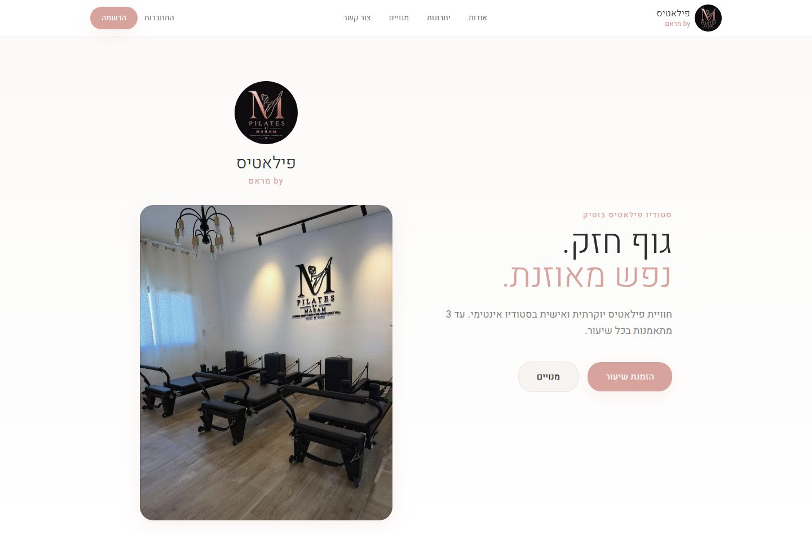
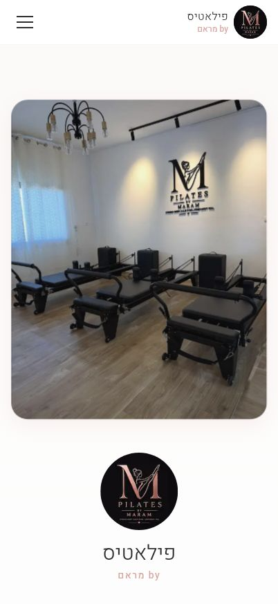
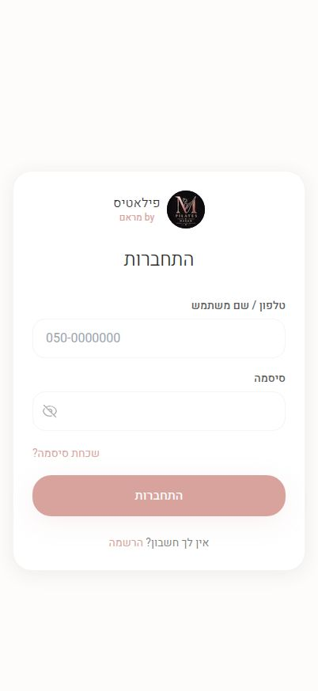
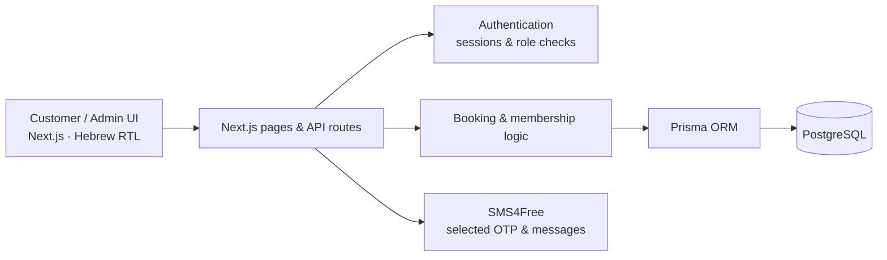

# Pilates by Maram — Studio Booking Platform

**Production full-stack application · Independent development · Hebrew / RTL**

[**View live website ↗**](https://pilates-maram.com) · [**Architecture & engineering notes**](ARCHITECTURE.md)

A customer-facing booking and membership platform built for a real Pilates studio. Members can browse classes, manage bookings and use membership credits; administrators manage schedules, customers and memberships.

> **Portfolio case study:** This repository contains documentation and public-page screenshots only. The production application source code, customer records and private configuration are not shared.

## Product preview

| Mobile homepage | Mobile sign-in |
|:--:|:--:|
|  |  |

*Screenshots show public, unauthenticated pages; no member or admin data is shown.*

## What I built

**Role:** Independent full-stack developer — application development, delivery and ongoing maintenance.

- **Customer experience:** Responsive Hebrew/RTL interface, account registration, phone/password login, class browsing and bookings.
- **Membership logic:** Credit-based memberships, booking eligibility, credit consumption and cancellation/refund policies.
- **Studio administration:** Class schedules, members, membership approvals, bookings, studio settings and manual credit adjustments.
- **Communication:** SMS one-time codes for registration/recovery, selected studio messages and in-app notifications.
- **Payments:** Off-app payment handoff options; no in-app card processing or settlement webhook is claimed.

## Technology

| Layer | Technologies |
|---|---|
| Frontend | Next.js 14 App Router, React 18, TypeScript, Tailwind CSS 3, Framer Motion |
| Backend | Next.js route handlers, role-checked server-side operations |
| Data | PostgreSQL, Prisma ORM |
| Authentication | bcryptjs, jose-signed sessions |
| Integrations | SMS4Free |
| Scheduling | date-fns, date-fns-tz, Asia/Jerusalem timezone rules |

## System overview

The database model includes users, membership plans, user memberships, classes, bookings, settings, testimonials, notifications and blocked dates. [Read the architecture details →](ARCHITECTURE.md)

## Engineering highlights

- **Consistent credit updates:** Booking and membership-credit writes use a database transaction, with a unique customer/class booking constraint.
- **Policy-driven cancellations:** Cancellation cutoff and optional credit refunds are based on studio settings; associated changes are saved together.
- **Access boundaries:** Customer and administrative operations use server-side session and role checks.
- **Local-time scheduling:** A shared helper converts Israel local class times with seasonal timezone offsets.

These describe implemented design choices, **not** a claim of complete concurrency or security validation. Known boundaries and additional detail are documented in [ARCHITECTURE.md](ARCHITECTURE.md).

## Verification scope

The following checks were reported for the **original application** during portfolio preparation:

- **3 focused automated tests passed:** Israel summer/winter time conversion and distinct class start times.
- **TypeScript check passed:** `tsc --noEmit`.
- Public homepage and login views captured at desktop/mobile sizes.

A comprehensive end-to-end, load, payment, or security test suite is **not claimed**. The documentation-only repository itself does not contain the private application code or runnable tests.

## About this repository

The codebase and original Git history remain private to protect production operations and client data. This public case study presents the product, verified architecture, technical decisions and public screenshots. No source-code license is granted here.

**Live application:** https://pilates-maram.com
